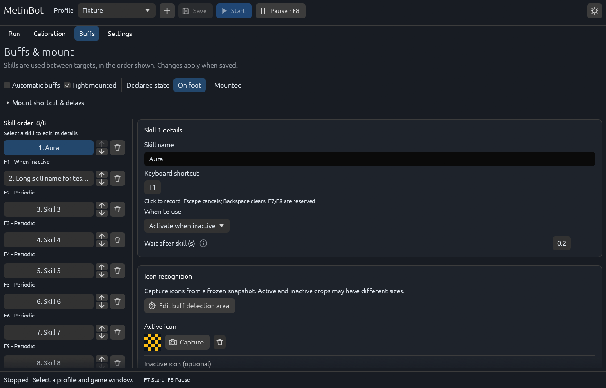

# MetinBot

A local Rust/egui desktop application for calibrating Metin recognition, selecting one target at a time and scheduling buffs. Screenshots, profiles and processing stay on your computer; the application does not read game memory or upload game data.

**Status: Windows Rust prerelease.** Real-game acceptance is still pending. Linux has a tested editor/vision build; Linux and macOS capture/input are unavailable, so Start is disabled there. macOS native execution still requires verification. See [platform support](docs/rust/platform-support.md) and the [release checklist](docs/release-readiness.md).



## Install on Windows

Requires Windows x64, Windows 10 2004 / build 19041 or newer, and a D3D11-capable graphics device.

1. Download the Windows **prerelease** installer and `SHA256SUMS.txt` from [GitHub Releases](https://github.com/ethanjojo/metin2-bot/releases). A locally prepared build is not a published GitHub release.
2. Compare `Get-FileHash .\MetinBotSetup-<version>-windows-x64.exe -Algorithm SHA256` with its checksum entry.
3. Run the installer and confirm the normal Windows administrator prompt. Launch MetinBot from the Start menu.
4. On first launch, import an older data folder or start fresh. The application always starts stopped.

Alternatively, extract the entire Windows ZIP into a writable location and run `MetinBot.exe`. Keep the executable, DLLs, licenses and other package files together. No Rust, Python, Node.js or OpenCV installation is needed on the user's computer.

The application and installer are currently unsigned. `jojo` is the file metadata publisher, not a verified Windows publisher. Checksums establish file integrity, not publisher identity.

## First setup

Select/create a profile in the top bar, then open **Calibration**. Search for the game window in the profile's window picker and take a **Snapshot**. Define the search area, excluded areas, Metin color, target panel and a distinctive reference crop. Configure skills under **Buffs**, save, and review readiness under **Run**.

**F7** starts; **F8** pauses. Automation requires the selected game to remain in the foreground. Use live preview for observation and a frozen snapshot for editing. See the [user guide](docs/user-guide.md) for calibration, icons, shortcuts and troubleshooting.

## Data and migration

Windows data is stored under `%LOCALAPPDATA%\MetinBot`; logs are in `logs/run.log` below it. Profiles include their recognition PNG assets. Back up the complete data directory.

The Rust application reads/imports the original profile format and legacy `config.json`. Import copies into an empty destination and preserves the source. Uninstall retains user data. Back up before upgrading a prerelease. The original Python application has been removed from the current tree; its historical implementation is recoverable at commit `5af7ea98536f9884969f38b7eb9b1077c5910a49`.

## Development

Requires Rust **1.99.0**, the platform's C++ build tools, and native OpenCV/Clang dependencies. Dependencies are locked in `Cargo.lock`. Windows development also uses PowerShell 7 and 7-Zip.

```powershell
./tools/prepare-rust-native.ps1
. ./tools/rust-env.ps1
cargo test --workspace --all-targets --all-features --locked
cargo fmt --all -- --check
cargo clippy --workspace --all-targets --all-features --locked -- -D warnings
cargo run -p metin-desktop -- --data-dir build/dev-data
```

Use an explicit development data directory to keep test data separate from normal profiles. `run.cmd` launches an existing Rust release build with the normal Windows elevation prompt; it does not install build tools.

Python is used only by packaging/verification tools. Install `requirements-build.txt` into a build virtual environment and run `python -m unittest discover -s tests -v`. See [build instructions](docs/rust/README.md), [native Linux/macOS packaging](docs/rust/unix-desktop-integration.md) and [release procedure](docs/releasing.md).

## Project layout

| Path | Purpose |
| --- | --- |
| `crates/metin-core` | Profiles, validation, controller and scheduling |
| `crates/metin-vision` | OpenCV detection and template matching |
| `crates/metin-platform` | Native capture, input and capability guards |
| `crates/metin-desktop` | egui application, persistence and runtime worker |
| `tests/parity` | Sanitized, immutable reference fixtures |
| `tools`, `packaging` | Build, verification, installer and branding resources |

Build outputs, downloaded toolchains, screenshots/logs, local settings and profiles are ignored. Icon source files and generated platform icon assets are intentionally versioned; regeneration uses the supplied SVG and pinned sharp 0.35.5, independently of application builds.

See [CHANGELOG](CHANGELOG.md) for current changes and [release notes](docs/release-notes.md) for prerelease limitations. Third-party license files are included in distributions. A project source-code license has not yet been selected by the owner; no open-source license grant is implied.
