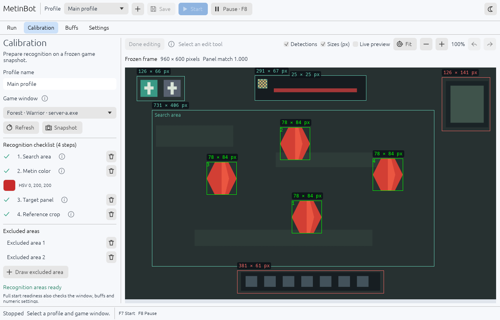
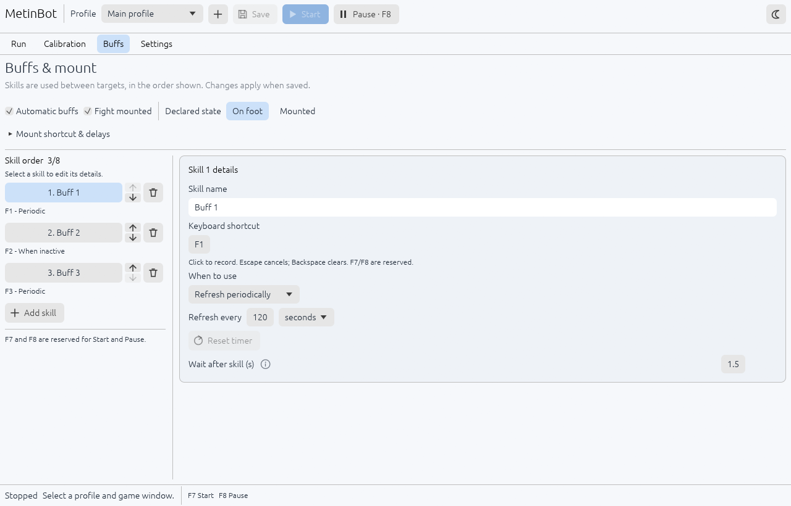
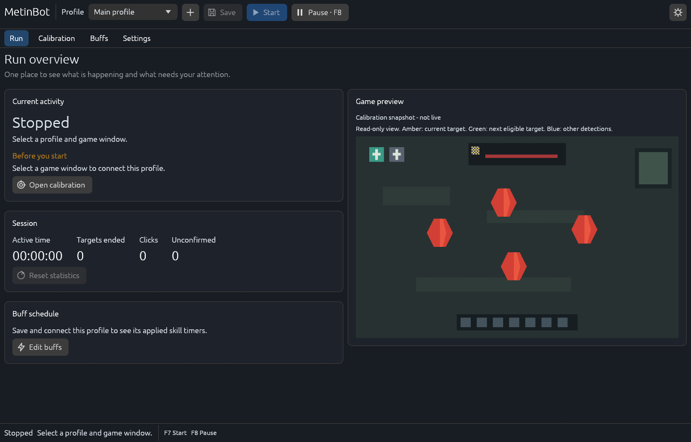
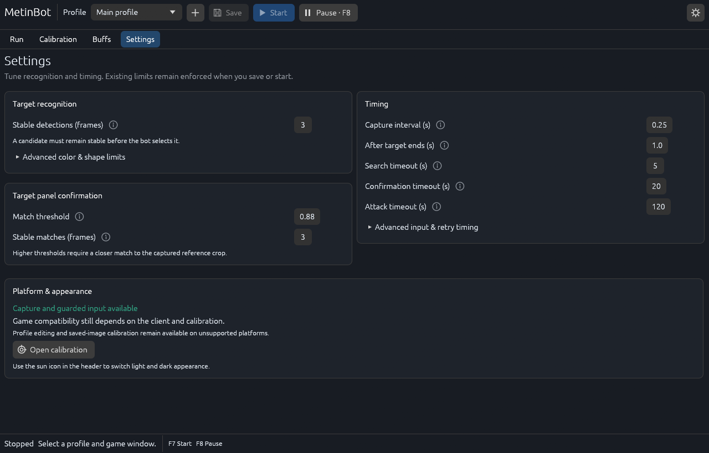

<picture>
  <source media="(prefers-color-scheme: dark)" srcset="packaging/icons/logo-dark.svg">
  
</picture>

# MetinBot

A Rust desktop app for visual target recognition, calibration and buff scheduling, built with **egui** and **OpenCV**. Processing and profiles stay on your computer.

[Download prereleases](https://github.com/ethanjojo/metin2-bot/releases) · [User guide](docs/user-guide.md) · [Development](docs/development.md)

<a href="docs/assets/calibration-dark.png">
<picture>
  <source media="(prefers-color-scheme: dark)" srcset="docs/assets/calibration-dark.png">
  
</picture>
</a>

*Actual application views using an isolated demonstration profile and a geometric sample scene. These images do not show a live game session.*

## What it does

- **Run** — readiness checks, current activity and a preview of detected targets.
- **Calibration** — window selection, snapshots, color picking, editable regions, zoom and undo/redo.
- **Buffs** — ordered skills, shortcuts, timed refresh and active/inactive icon recognition.
- **Settings** — recognition, timing and input safeguards, with light and dark themes.
- **Profiles** — separate calibration, skills and remembered game-window selection for each setup.

## Get started on Windows

Requires **Windows x64, Windows 10 version 2004 / build 19041 or newer**, and a D3D11-capable graphics device.

1. Download the installer or portable ZIP and `SHA256SUMS.txt` from [Releases](https://github.com/ethanjojo/metin2-bot/releases). Compare the file's SHA-256 checksum before installing.
2. Install and launch MetinBot, or extract the **entire** ZIP and run `MetinBot.exe`. Packages include the required runtime libraries.
3. Create a profile. In **Calibration**, select the game window and take a **Snapshot**.
4. Set the search area, exclusions, Metin color, target panel and reference crop. Configure **Buffs**, then save.
5. Review readiness in **Run**. **F7** starts and **F8** pauses. Keep the selected game in the foreground.

The app starts stopped. Live preview is for observation; take a snapshot before editing. The [user guide](docs/user-guide.md) explains every setup step and common validation messages.

**Prerelease:** the full in-game cycle still needs acceptance testing. Windows packages request administrator confirmation and are currently unsigned; `jojo` is product metadata, not a verified publisher.

## A closer look

### Buffs

<picture>
  <source media="(prefers-color-scheme: dark)" srcset="docs/assets/buffs-dark.png">
  
</picture>

### Run

### Settings

## Platform support

| Platform | Current scope |
| --- | --- |
| Windows x64 | Prerelease with native window capture and guarded input. Full game-cycle acceptance is pending. |
| Linux | Editor, recognition and desktop integration preview. Automation is disabled. |
| macOS | Editor and application bundle support. Full native execution and Dock/Finder appearance still require verification. Automation is disabled. |

See [platform support](docs/platform-support.md) for verification boundaries.

## Your data

Windows stores profiles, settings and logs in `%LOCALAPPDATA%/MetinBot`. Back up the complete folder, including PNG assets. Import copies a data folder without modifying its source; uninstall retains user data. Other platform paths and troubleshooting are in the [user guide](docs/user-guide.md).

## Build and contribute

The workspace uses **Rust 1.99.0** with locked dependencies. Native OpenCV and Clang are required. Follow [development setup](docs/development.md) for platform prerequisites, tests and reproducible screenshots.

| Directory | Responsibility |
| --- | --- |
| `crates/metin-core` | Profiles, validation, targeting and scheduling |
| `crates/metin-vision` | Detection, image processing and template matching |
| `crates/metin-platform` | Native capture, input and platform capabilities |
| `crates/metin-desktop` | egui interface, persistence and runtime worker |
| `tests/parity` | Reference images, profiles and controller traces |
| `tools`, `packaging` | Build verification, installers, icons and license notices |

[Changelog](CHANGELOG.md) · [Prerelease notes](docs/release-notes.md) · [Release procedure](docs/releasing.md)

Third-party notices are included in distributions. A source-code license has not yet been selected by the owner.
