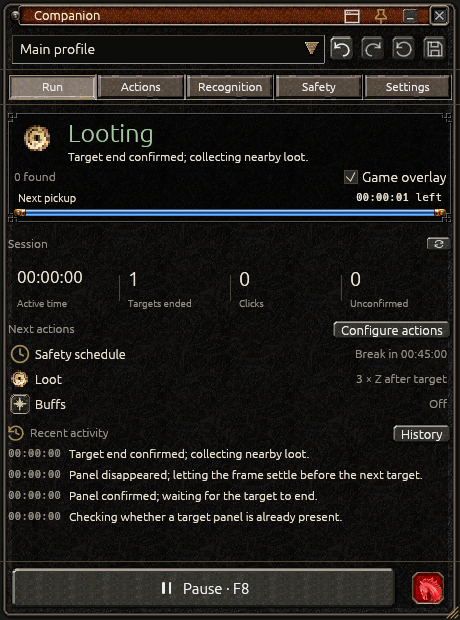
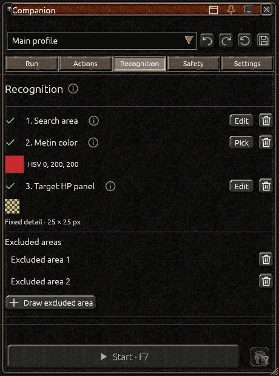
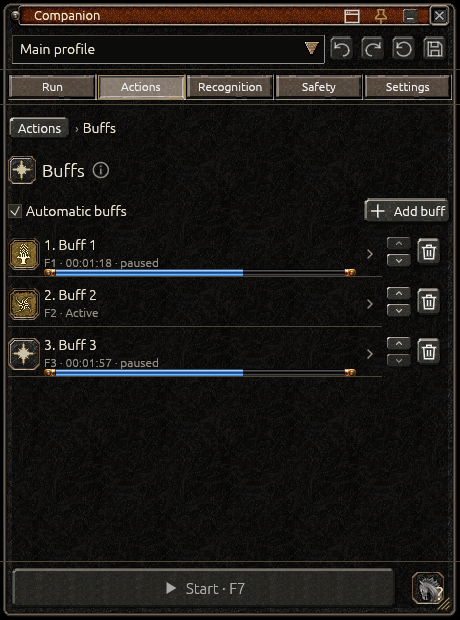

<picture>
  <source media="(prefers-color-scheme: light)" srcset="docs/assets/companion-logo-light.svg">
  
</picture>

# Companion

A **Metin2 bot for Windows** with a compact in-game-style panel. Configure target detection, buffs, loot and other actions, then follow the run beside your game window.

[Download](https://github.com/ethanjojo/metin2-bot/releases) · [User guide](docs/user-guide.md) · [Actions guide](docs/actions.md) · [What's new](docs/release-notes.md)

## What it does

- Finds Metins using your chosen color or detection preset and confirms targets through a captured HP-panel detail.
- Handles timed or image-based buffs, loot, mount behavior, periodic actions and auto-puller items.
- Reacts to captured visual conditions with a notification, pause, key press or click.
- Shows target outlines over the game, upcoming actions, session statistics and event history.
- Supports separate profiles, scheduled breaks, stop limits and updates inside the app.

## Get started

Requires **64-bit Windows 10 version 2004 or newer**, with Direct3D 11 graphics support.

1. Download and run **CompanionSetup** from [Releases](https://github.com/ethanjojo/metin2-bot/releases).
2. Read the installer disclosure and approve administrator access. The required input driver also changes Windows certificate trust and the GameInput service; see [installation details](docs/installation.md).
3. Open Companion, choose your game window and create a profile.
4. Set up **Recognition**, then choose the **Actions** and optional **Safety** settings you want.
5. Save and press **F7** to start. **F8** pauses immediately.

Companion starts paused. Keep the selected game in the foreground while the bot runs; switching to another app pauses gameplay input. [Follow the first-setup guide](docs/user-guide.md#first-setup).

## Set it up your way

Select areas and reference images directly over a frozen view of the game. Move or resize an existing selection, confirm it, or press Escape to cancel. Pin the panel beside the game or collapse it to its title bar.

*Screenshots show the actual app with a demonstration profile and synthetic game imagery.*

## Updates and your profiles

Companion checks for updates when it opens. You can also check in **Settings → Updates**. **Stable** offers regular releases; **Preview** includes testing versions. Installation happens only after you choose it.

Profiles and settings are stored in **%LOCALAPPDATA%/Companion**. Updates preserve them, and ordinary uninstall keeps your data. Back up the complete folder or export individual profiles from the profile selector.

## Contributing

For source builds and technical details, see [Development](docs/development.md), [Release procedure](docs/releasing.md) and the [Changelog](CHANGELOG.md).

Project-authored code is [MIT licensed](LICENSE). Game artwork and dependencies retain their own terms; see [Third-party notices](THIRD_PARTY_NOTICES.md).
