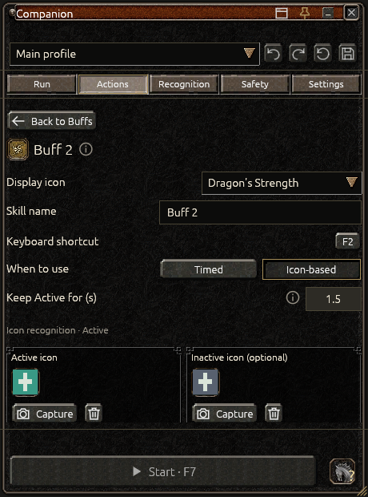
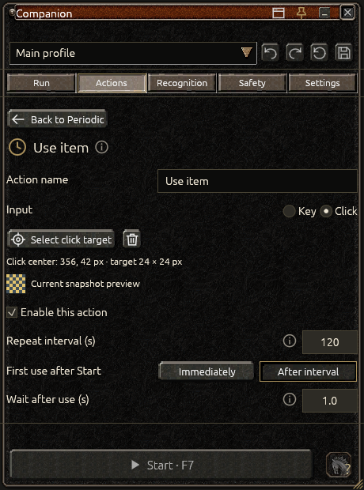
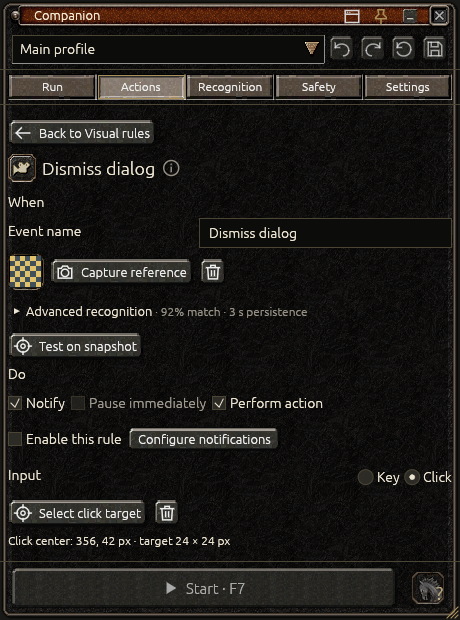

# Actions guide

Choose **Actions**, then select a behavior to configure it. Save edits before running. Start with one behavior, check it in your game, then add others.

## Buffs

Turn on **Automatic buffs**, then use **Add buff**, enter a name and record its shortcut. Small arrows change its order; the trash removes it. Select a list item to edit it.

- **Timed:** use the buff at the chosen interval.
- **Icon-based:** activate it when recognition confidently confirms it is inactive.

For an icon-based buff, capture its **Active** image and, if needed, a distinct **Inactive** image. Companion opens the game selection overlay, shows the captured preview and lets you return to Buffs when finished. The detection area is added or expanded around captured icons; edit it if they can appear elsewhere.

Use **Check recognition** before enabling. **Active** means the active appearance was seen; **Inactive** means it was confidently absent or its inactive appearance was confirmed; **Unknown** means Companion cannot decide. Unknown does not cause a toggle key to be pressed.

**Keep Active for (s)** smooths brief animation changes. Its default is 1.5 seconds; 0 disables it. A recognized active icon refreshes the hold. Ambiguous images do not keep extending it. Use distinctive references rather than increasing the hold to hide an incorrect match.

The display-icon picker contains four classes and both specializations. It changes artwork in the list and Run, not recognition images. Timed buffs show countdowns; image-based buffs show their recognized state.

## Mount

In **Actions → Mount**, choose whether combat should be mounted and record the mount shortcut and delays. Mount handling is part of **Automatic buffs**.

The horse icon in the footer tells Companion the character's **current** state: grey/question mark = unknown, red = on foot, green = mounted. Confirm it by looking at the character. Changing this declaration never presses the mount shortcut.

Each new connection starts unknown. Confirm again after switching character/window or restarting Companion. No screenshot is needed.

## Loot

Enable loot, record the pickup key and choose the delay, number of presses and hold/gap durations. Loot runs after a confirmed target ends. It presses the pickup key; it does not recognize item names or inspect inventory.

## Periodic actions

Use **Add action** for a named shortcut or click, such as using an item. Record its key or select a click area, then turn on **Enable this action**. Choose the interval, first use immediately or after the interval, and wait after use.

Actions wait until the bot is between targets. Timers count running time and pause with the bot. Missed repetitions are not queued into a burst. Waiting after a key press does not prove that the game action succeeded.

For a click, select the game's button area. Review it after moving the game's UI or resizing the client. A single shortcut cannot complete a multi-step NPC conversation by itself.

## Visual rules

Use **Add rule** to respond to something appearing on screen. The editor follows **When → Do → Then**.

1. **When:** capture a distinctive fixed part of the event; choose similarity and how long it must remain visible.
2. **Do:** choose **Notify**, **Pause immediately**, **Perform action**, or a supported combination. An action can press a key or click a selected area.
3. **Then:** choose how to check completion and whether to continue or pause afterwards.

For example, capture a fixed part of a respawn dialog, choose **Perform action**, then select its respawn button as the click area. Test both the normal scene and dialog before enabling.

**Notify** can accompany a pause or action. **Pause immediately** cannot accompany an action. To act first and pause afterwards, use **Perform action** with **Pause** after completion.

With **Verify**, Companion waits for the reference to disappear after the action. Retries stop at **Maximum attempts**; exhausting them pauses the bot. With **Wait**, only the delay is checked, not whether respawn or another action succeeded. Choose **Continue** only when the next game state is safe to recognize again.

A rule fires once while its condition remains visible. It can fire again after disappearing and reappearing. F8, focus loss or a game-size change cancels the action. Use your own captures; no universal death or disconnect images are supplied.

## Auto-puller

Enable **Automatic puller** and record the hotbar item's shortcut. Choose either:

- Use at the start of confirmed combat, with a chosen number of presses.
- Repeat at an interval while combat is confirmed.

Adjust hold, gap and wait durations for your item. Combat confirmation uses the target HP panel. The puller does not repeat while searching, on a break or after the target ends. Pressing the item key does not confirm that monsters were attracted.

## Out-of-target attack

Use this for monsters left after a Metin is destroyed or attacking during a long search.

- **After combat:** hold the attack key for the chosen duration after the target ends, before loot.
- **During long searching:** after the chosen search time, hold the key for a limited duration, then resume searching.

For continuous Space attack, choose Space: the key is held, not repeatedly tapped. Set the maximum search attacks to bound it. A new target, F8, lost focus or a capture problem releases the key. A finished hold does not prove all nearby monsters are dead.

## How actions fit together

A typical cycle is: target ends → optional out-of-target attack → loot → settling → due break → buffs → periodic actions → next target. Safety stops and visual rules can interrupt it.

Timed actions use active running time. Changing profile or connection starts a new session. If something stops unexpectedly, read its reason and **Run → History** before restarting.

[User guide](user-guide.md) · [Safety and limits](user-guide.md#actions-and-safety) · [Troubleshooting](user-guide.md#data-and-troubleshooting)
