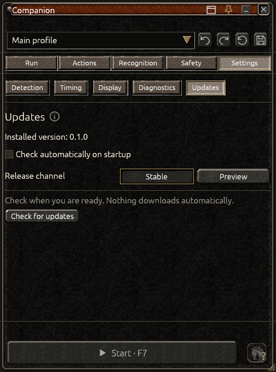
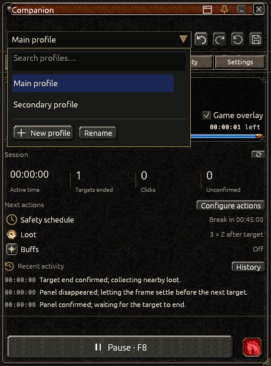
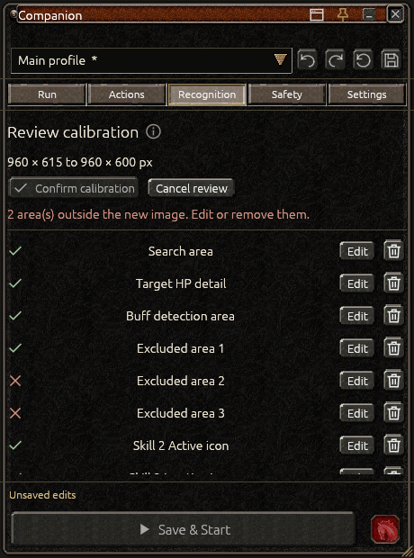
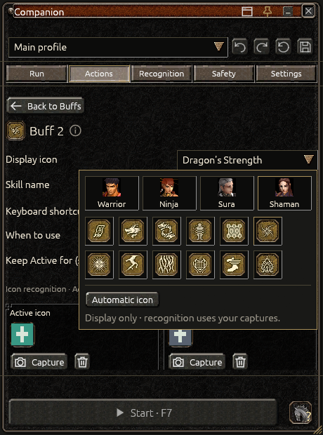
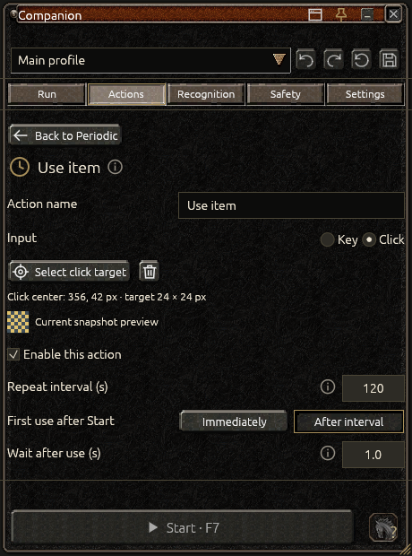
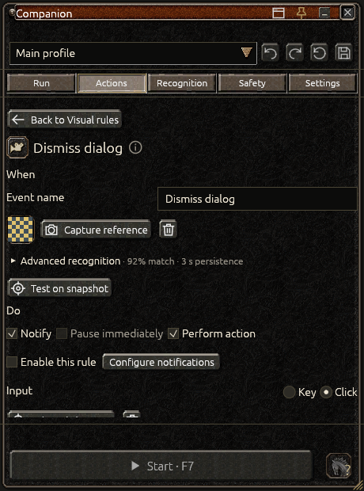
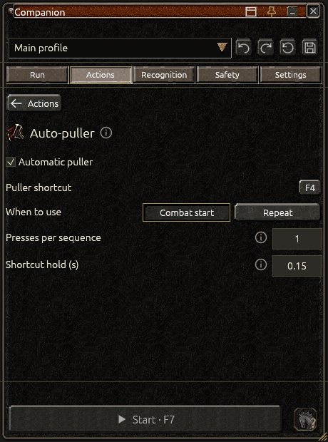
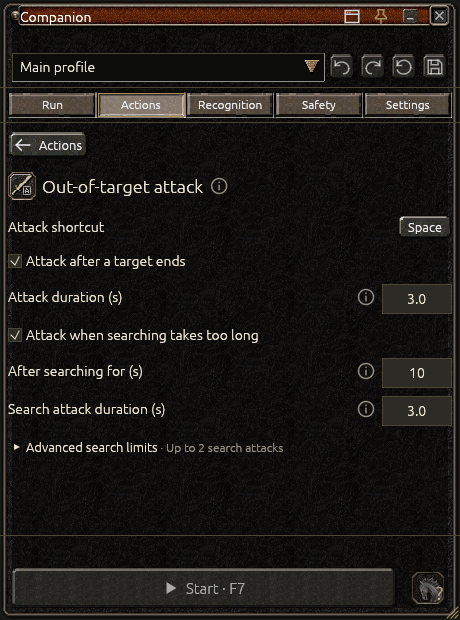
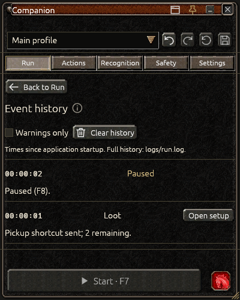

# User guide

## Installation and HID driver

Use the Windows x64 setup installer and verify it against the release's `SHA256SUMS.txt`. Windows 10 version 2004 / build 19041 or newer and a D3D11-capable device are required. Setup requires administrator approval and installs the mandatory generic HIDMaestro v2.1.0 driver. Setup discloses creation of the `CN=HIDMaestroTestCert` RSA 2048/SHA-256 code-signing certificate with an exportable private key stored in machine `My` and certificate trust copies in machine `Root` and `TrustedPublisher`. It also discloses configuring/starting `GameInputSvc` for automatic startup before continuing. Review that disclosure; these changes affect Windows beyond the application folder.

The bundled `MetinInput.dll` contains the pinned MIT HIDMaestro SDK compiled with NativeAOT. No .NET runtime installation is needed. Automation uses this one HID input path. A missing bridge, incompatible ABI or unavailable driver prevents Start and provides a reason; calibration and capture remain usable. Starting automation never installs a driver or certificate.

Uninstall retains profiles and the shared driver by default. Choose driver removal explicitly only when other HIDMaestro consumers are stopped; removal refuses when another consumer is running. Silent setup requires `/ACCEPTINPUTDRIVER=1`; silent uninstall opts into driver removal with `/REMOVEINPUTDRIVER=1`. Explicit removal deletes the certificate/private key when no driver package remains, but leaves `GameInputSvc` configured for automatic startup because its original setting is not recorded. Driver management and structured reports are documented in [development](development.md#driver-management).


## Updating Companion

Open **Settings → Updates** to check the installed version and choose **Check for updates**. **Check automatically on startup** is off by default; enabling it checks once per launch and never downloads or installs automatically. **Stable** is the default channel. Choose **Preview** explicitly to include prereleases. Checks use the public [Companion GitHub releases](https://github.com/ethanjojo/metin2-bot/releases) without an account or token and without sending profiles, captures or game data. Choose Preview to receive release candidates. Older package identities are filtered out. The offline views below demonstrate the interface; package availability comes from the live release feed.



When a compatible newer version is available, review its version, size and release notes, then choose **Download update**. The background download checks the published installer size and SHA-256 before offering installation. **Cancel download** stops the request and removes its partial download. A failed request or integrity check keeps installation unavailable; use **Retry check** when ready. See the native [available release](assets/update-available.png), [download progress](assets/update-download.png), [verified download](assets/update-ready.png) and [error](assets/update-error.png) examples.

**Install and restart** is a separate action available only after verification. Finish or cancel any capture/calibration review first. Companion pauses automation, resolves unsaved edits through the normal save/discard/cancel decision, waits for held inputs to release and opens the canonical Inno setup installer. Cancelling the unsaved-edit decision keeps the application and edits open. Setup still requires administrator approval and its normal HIDMaestro driver consent; an update does not silently approve machine changes. Companion restarts only after successful setup and remains paused. Cancelling or failing setup does not resume automation. Save a backup of the complete data folder before upgrading.

Discarding or cancelling a download cleans up its private temporary files. After a successful installer launch, Windows may keep the cached installer in its temporary directory while setup is using it. It contains the downloaded setup package, not your profiles.

## Compact panel, profiles and game window

On launch, a searchable grid shows the available window names and screenshots. Select a tile to connect and open the 460 × 620 Companion panel; it can be resized down to 400 × 480. A thumbnail that cannot be captured shows its reason instead of an image from the desktop. Drag the Companion title to move it; use the lower-right grip to resize. The title-bar controls change the connected window, pin the panel to it, collapse the panel or close it. The interface uses one fixed Metin appearance. Companion installs in `Program Files/Companion` and uses `%LOCALAPPDATA%/Companion`. Existing default paths migrate with complete verified backups; profile formats stay unchanged. Close previous instances first. The shared driver remains HIDMaestro.

The title strip follows the original artwork height, with aligned Window, Pin, Collapse and Close controls. The Metin-style profile combobox opens profile search, New profile and Rename. Undo, Redo, Revert and Save remain visible beside the selector and are disabled when unavailable. Revert restores the last saved profile transaction and retains the connection. Save persists the complete recognition setup, settings and skills. The footer keeps a wide Start/Pause control and one horse icon on every tab. Start saves draft edits before its countdown; F7 starts the already applied profile. Both are blocked during calibration size review. Editing controls are unavailable during native selection; Escape/F8 cancels the selection and F8 remains emergency pause. Selects share a recessed field, original game arrow, matching full-width popup and clear hover/selection. Keyboard navigation, Enter, Escape and accessible value labels remain available.



Short feedback confirms completed saves, selections and removals in a fixed space above the footer. A removal's **Undo** restores that edit while its message is current; another edit or profile change retires the message. Missing prerequisites show the action needed to continue. Changes remain drafts until Save; feedback does not imply that a capture or profile was saved automatically. Numeric fields keep their units visible, secondary text stays readable over the dimmed Metin background, and Start/Pause stays in the same footer.

Connection belongs to the current application session, independently of profiles. Switching profiles pauses automation and retains the exact selected window. The title-bar window icon reopens the grid; search by title, application filename or process ID. Catalog and visible thumbnails refresh automatically. Closing or replacing the selected window returns to the chooser. A new application launch always asks for an explicit selection; old remembered-window preferences are discarded when settings are next saved.

Pinning makes the panel follow the selected game's client geometry. It is raised while that game or the panel is active, and gives up that level when another application becomes active. When the target is minimized or hidden, an inactive pinned panel hides with it and returns without activation when the target returns. An active panel remains usable for selecting another target; a destroyed target also leaves the panel available. Unpinning restores normal independent window behavior. Moving or viewing this control panel does not grant it permission to send game inputs.

## Recognition and capture

Select the correct game window, then complete the three recognition steps:

1. **Search area:** select the playable scene. Add excluded areas for chat, the minimap or other false matches.
2. **Metin color:** click a representative target pixel. Detection settings control tolerance, dimensions and stability.
3. **Target HP panel:** capture one distinctive fixed edge or symbol. Avoid the changing HP fill, character names and the full variable-width panel. The reference must be at least 5 × 5 source pixels and have enough visual detail; uniform crops can be rejected.

Choosing a capture tool automatically pauses automation and requests a fresh image of the selected client. Selection opens only after the worker confirms held inputs have been released. There is no separate Refresh or Snapshot step. The native selector dims the frozen image outside the selection and keeps selected pixels clear. Drag a rectangle, move it from its interior, or resize it using an edge or corner handle. An existing region starts selected on the fresh image; drawing outside it replaces the region. The contextual controls appear outside the selected rectangle after drawing, leaving the image clear while drawing. For a color sample, click to lock the pixel and inspect the color swatch and candidate outlines in the same frozen image before confirming. Check the source-pixel dimensions/readout and choose **Confirm selection** or press Enter. Escape, F8, the Cancel control or right-click cancels. Tab temporarily hides the controls and magnifier so every source pixel remains reachable. Selection itself sends no input into the game.

Opening a selection creates a private draft and leaves the current profile, color, reference pixels and undo history unchanged. Escape/F8/Cancel discards that draft. Confirm applies one validated edit that can be undone in one step. A confirmed selection passes through the normal editor validation. Buff and action captures retain their source editor, thumbnail and manual return control; inspect the result before returning and saving. A failed selection shows its reason instead of replacing a valid crop. A profile/window change, target loss or cancelled request invalidates an old selection. If game dimensions differ from the profile, the selector reports both sizes and offers **Review calibration** or **Keep original**.

The fixed HP detail is always matched anywhere inside the connected game client window. Existing saved search restrictions are discarded without changing the reference. HP matching never searches the desktop or monitor. Use Excluded areas for target masks; the confirmed matched HP detail is excluded automatically. Similarity and consecutive stable-frame requirements still apply.

Live annotations mark current, next and other candidate targets directly over the selected game. The current detected target has a green outline; no fixed cross remains at its previous click position. The next target keeps its gold marker. Recognition groups the **Game overlay** master with **Detected targets**, **Calibration areas** and **Sizes (px)**. Suboptions are disabled but retained while the master is off. Calibration areas controls the selected recognition outline. The annotation window is read-only, click-through and does not activate itself. It hides when frames become stale, target focus/visibility is lost, the target is minimized or replaced, the profile/window changes, or the app shuts down. It does not bypass focus, occlusion or input guards.

Companion requests borderless capture through the supported Windows permission API, shared by live capture and window thumbnails. Windows may ask for consent; its privacy policy remains authoritative. Older Windows versions or denied permission can retain the system capture border. No global privacy setting is changed. When paused with Game overlay off, after a single capture, on disconnect or shutdown, Companion closes its capture session rather than leaving a capture indicator active unnecessarily.

### Editing recognition

All region, color, buff and action selection uses the same native overlay. There is no separate screenshot canvas or zoom editor in Companion. Reopen a tool to adjust its saved region on a fresh image. Row trash icons remove the corresponding area/color/icon; the top Undo/Redo controls restore profile edits. Game overlay is global across tabs, with its visible targets, calibration areas and dimensions configured in Recognition. Paused annotation previews reflect draft recognition edits; running automation always uses the applied runtime profile.

### Calibration size review

Choose **Review calibration** after a size-change notice to inspect a fresh image of the current game client. Automation pauses and held inputs must be released before review starts. Existing areas retain their physical client-pixel positions; reference PNGs and sampled colors are kept. Coordinates are not automatically scaled or clamped to fit the new image. **Keep original** leaves the existing calibration untouched; restore the old client size to use it, or keep a separate profile for the new layout.

The review lists the search area, exclusions, fixed HP detail, buff detection area, Active/Inactive buff icon positions, visual-rule reference positions, and visual-rule/periodic click targets. Use **Edit** to adjust any area on a frozen client image or the trash control to remove it from the draft. All preserved region outlines appear together: gold for valid areas and red with **outside image** for areas beyond the current image. Red outlines are clipped for display only. Edit or remove every invalid area before confirming; removing a required area can require recalibration before the profile is valid. Captured PNG pixels remain unchanged unless you explicitly replace or remove a reference. Metin color can also be sampled again if needed.

**Confirm calibration** requires a fresh, visible capture from the same connected window, unchanged client dimensions, no active selection and valid reviewed areas. It accepts the whole draft as one undoable profile edit; Save then persists/applies it. GUI Start and F7 remain blocked while review is active, including from the already applied runtime profile. A change of profile/window or another client-size change cancels the review and rejects stale results. Automation stays paused after confirmation or cancellation.

**Cancel review** or Escape cancels the entire size review, including its intermediate edits, and restores the previous calibration, reference pixels and undo/redo history. This also applies when Escape cancels a native selection opened from the review.



## Actions

Each of the seven behavior categories has its own icon in the Actions list and the same icon beside its detail heading. Periodic actions use a clock; the hourglass represents waiting and breaks.

Each category summarizes its current edited configuration as **On**, **Off** or **Setup needed**, with the relevant shortcut, interval or missing requirement. These summaries describe the draft; Save applies it to automation. Advanced groups expose their configured values while collapsed. Essential hold/wait fields and click-target previews remain visible directly in their forms.

### Buffs

Choose Buffs from the Actions list, then select a skill to open its shortcut, mode and timing details. **Timed** refreshes it on the configured interval; **Icon-based** activates it when recognition confirms it is inactive. Both choices are directly visible. Back to Buffs returns to the list; Actions returns to all behaviors. The two compact arrows beside its list button reorder it; the adjacent trash icon removes that skill. For Icon-based skills, capture the active icon and, when needed, a distinct inactive appearance. Capturing an icon automatically creates or expands the buff detection area with a small margin. Edit buff detection area remains available when a wider search region is needed.

Each capture control requests a fresh frozen game image labelled with the skill and capture type. Confirm the crop, inspect its thumbnail, then use Done & back to buffs. A failed capture shows the validation reason and does not replace a valid saved icon. Configure the actual current On/Off state before running when the skill requires it.

The skill's display icon is chosen separately from its captured Active and Inactive references. Open its icon picker and choose Warrior, Ninja, Sura or Shaman. Both specializations are available: 10 Warrior, 10 Ninja, 12 Sura and 12 Shaman icons, 44 in total. Built-in tooltips and accessible labels use official English base-skill names, such as **Aura of the Sword** and **Dragon's Strength**. Your own profile and skill names are retained. Changing this icon affects the skill list and Run artwork; it does not replace recognition captures or change when a key is sent. Existing profiles keep their captures and can leave the display icon unset.



### Loot

In Actions → Loot, enable Automatic loot and record the game’s pickup shortcut. Set the number of presses, initial delay, wait between presses and key hold duration. Loot starts only after a confirmed target panel disappears for the configured number of frames. Startup, unconfirmed clicks and search rotations do not trigger it. It sends a pickup shortcut; it does not recognize item names or inventory contents. A target panel reappearing interrupts pickup and pauses automation.

### Mount

The single horse icon in the fixed footer records the current On foot / Mounted declaration. Red means On foot; green means Mounted. The icon has no additional enclosing frame. Grey with a question mark means Unknown: click it and explicitly choose On foot or Mounted. Once confirmed, clicking toggles the declaration to the other state, with a matching tooltip. The icon waits for runtime acknowledgement and is disabled while disconnected or selecting a capture. No capture or recognition setup is required. Confirmation pauses automation and never sends a mount shortcut to the game. Actions → Mount contains desired Fight mounted behavior, the actual mount shortcut and delays; those settings apply on Save. Mount handling runs as part of Automatic buffs.

Each new profile/window connection starts with unknown mount state. Check the character and select On foot or Mounted before starting automatic buffs. Saving the same connected session preserves its declaration; switching connections or restarting the app requires a new declaration. The state is never borrowed from another character.

### Periodic actions



In Actions → Periodic actions, use Add action to create a named key or click action. For a key, record the shortcut and set its inline hold duration. For a click, choose **Select click target** and select its area in a fresh frozen game image; the target preview and any missing-target reason are visible directly. Set the repeat interval and inline wait after use, then enable and save. First use after Start offers **Immediately** or **After interval** (the default for new actions) without opening a menu. Actions from older saved profiles retain immediate first use; saving writes the updated format.

Actions run between targets, never during combat. After successful input, the next interval starts after the configured wait. Manual pauses and scheduled breaks freeze these intervals. The wait is only a delay: it does not verify that an item was used or a game action succeeded. This is a single input, not a dialog sequence.

The action and its animation wait do not consume the search timeout. Time already spent searching is retained when searching resumes.

Click areas use source pixels relative to the calibrated game window, not desktop coordinates. Select a stable button area and review it after changing game size or layout. A changed frame size preserves saved click areas and offers [calibration size review](#calibration-size-review); no click target is automatically scaled or clamped. Focus, window and input guards apply to clicks as well as keys.

### Visual rules



In Actions → Visual rules, use Add rule and name the event. There are no death/disconnect presets or supplied game images. Capture a distinctive fixed part of the event (5–128 source pixels), inspect its thumbnail and return to Visual rules. Test on snapshot compares the reference with the frozen frame; compare normal and event snapshots before enabling. Set similarity and how long the event must persist. Missing or stale observations reset persistence; a rule fires once until its condition disappears. Enabled rules require complete calibration.

The editor follows **When → Do → Then**: When contains the captured condition, Do contains the reaction and input, and Then controls verification and completion. **Notify** is independent and can be combined with **Pause immediately**, **Perform action**, or used alone. Immediate pause and performing input are mutually exclusive; neither selection silently changes the other. A rule without any reaction cannot be enabled. Perform action uses one recorded key with inline hold duration or a calibrated click area with an inline preview. The app releases ongoing attack input and checks a fresh frame before sending the action. Click areas follow the same game-window-relative calibration rules as periodic clicks.

**Verify** is the default result check. After the configured wait, fresh consecutive frames must confirm that the rule's reference has disappeared. If it remains after the verification timeout, the action may retry, up to Maximum attempts (1–5 total attempts, including the first). Exhausting attempts pauses automation. Notify controls alerts from this rule, including retries and failures; history and warning reasons are always recorded. During a visual action, this also covers focus, capture and input errors. Scheduled automatic stops retain their independent alerts. When sound and system notifications are both off, the rule shows a shortcut to Safety → Notifications. **Wait** explicitly skips outcome verification: the event history records that only the delay completed. It does not prove revival, reconnection or any other game result.

After completion, choose **Continue** from a fresh frame or **Pause** (the default). This completion pause can be combined with performing an action; it is distinct from Pause immediately. Continue discards the interrupted sequence and recognizes the game state again; it does not resume stale clicks or attacks. If mount state became uncertain during interrupted buffs, the app pauses for a manual check. A visual action detected during a scheduled break pauses for review.

Pause/F8, focus loss, geometry changes, capture/input errors and automatic safety limits cancel execution and release held input. Cancelled work never resumes automatically after Start. Rules that pause take priority over action execution. Test recognition and the configured input in your own setup before enabling; live-game acceptance is still pending.

### Auto-puller



Assign the shortcut of your enemy-attracting hotbar item. **Combat start** sends one sequence after the target HP panel is confirmed. Choose the number of presses and gap between presses; shortcut hold stays inline, while applicable advanced timing shows its configured summary. A brief panel flicker or Pause/Resume does not trigger another start sequence for the same combat. **Repeat** sends a sequence immediately when combat is confirmed, then repeats after the configured post-sequence wait and interval. No puller inputs are sent while searching, acquiring a target, looting, buffing, recovering or on break. A pause cancels remaining presses; delayed samples never replay missed sequences.

Profiles saved with the previous Searching/Combat/Both periodic modes load as Repeat, preserving their shortcut/timing. The next save writes the new mode. Newly created profiles default to Combat start with the puller disabled.

### Out-of-target attack



Actions → Out-of-target attack has independent, default-disabled options for after combat and long searching. Set the attack shortcut (Space is supported).

After combat starts only after confirmed target-panel disappearance, holds the key for the configured duration, releases it, then continues with loot and settling. It does not run after startup or an unconfirmed click. During long searching triggers after the configured search time with no target; search/rotation settling counts, pauses and other actions do not. It holds the key for its own duration, then resumes fresh searching. A new panel or stable candidate interrupts a search attack before selection. Maximum search attacks is bounded; existing search/rotation/recovery limits still apply and may stop the run first. Attempt counts reset after confirmed combat or a manual Start, not Reset session.

These are timed key holds, not monster recognition: finishing a hold does not prove nearby enemies are dead. Vision and safety monitoring continue during a hold. A panel appearance, Pause/F8, focus/geometry change, capture failure or safety limit releases the key; no hold resumes automatically after a pause. Slow capture during a hold fails closed rather than continuing a blind attack.

## Safety

All options are per profile and disabled by default. Save applies edits; changing stop/break settings restarts the safety budget. Editing visual rules in Actions, recovery or notifications preserves that budget. Keep the game focused during scheduled breaks if you want automatic continuation.

- **Stop after active time:** counts searching, combat, buffs, pickup and settling. Manual pauses and scheduled breaks do not count. The limit interrupts guarded input and releases held keys, including during combat.
- **Stop at local time:** fixes the next occurrence of the chosen local time when a new run starts (tomorrow if necessary). This deadline continues through pauses and breaks. Later system-clock/time-zone changes do not move the already fixed deadline. During a daylight-saving gap the next valid occurrence is used; repeated local times use the first future occurrence.
- **Take regular breaks:** after the configured active interval, waits for the current target, loot and settling to finish. No inputs are sent during the break. Buff timers freeze and recognition restarts on a fresh frame afterwards.

If both stop limits are enabled, the earlier one wins. A completed automatic stop never restarts by itself: Start or F7 explicitly begins a new run and fresh safety budget. Pause, F8, focus loss or an error during a break cancels automatic continuation; the next manual Start begins a fresh break interval. Pausing outside a break preserves active-time progress. Reset session, Reset skill timer and Clear history do not reset safety limits. Changing profile/window or restarting the app begins a new runtime session.

The execution order is target end → optional out-of-target attack → loot → settling → break if due → buffs → periodic actions → next target.

### Recovery and notifications

Recovery optionally clears a timed-out target with Escape, rotates the camera and waits for fresh recognition. Attempts are bounded; exhausting the limit pauses. Recovery never counts a target completion or triggers loot. Attempts reset after a confirmed target end or manual Start.

Notifications optionally play a sound and/or submit a local system notification for rules, automatic stops and runtime errors. Test notification needs no game window. Delivery status and failures appear in Safety and Diagnostics. Windows notification settings and Do Not Disturb can suppress presentation. No remote messaging is configured.

## Run and stop

The bot always starts stopped. Review readiness, save, and use Start or F7. Run groups a visual activity emblem, state and reason, an actionable setup checklist, four session counters, next-action countdowns and recent events. The single History control opens the full event list inside Run. Game overlay shows annotations directly over the selected game across all tabs. Turning it off stops continuous presentation capture while paused without changing automation's detection and safety interval. The game must be foreground and match the profile. Input pauses or is rejected when identity, focus, size, permissions, occlusion or manual-input guards fail. Focus changes during the start countdown are allowed time to settle; execution still requires fresh, stable, active-target observations.

Pause or F8 stops the worker; do not rely on closing a game window as the primary stop control. Test the full game cycle before unattended use. The HIDMaestro bridge and installed driver must be available before Start.

The activity card reserves a thin timer strip. A known wait shows its actual remaining time and progress; searching shows elapsed time without a made-up percentage. Combat and target confirmation bars explicitly represent timeout limits, not target HP. Regular buff rows and details show time to next use with an interval bar; icon-driven buffs show Active, Inactive or Unknown from fresh recognition instead of an invented timer. Paused buff countdowns retain their remaining time.

Activity artwork follows the current runtime action: target attack, out-of-target attack, searching/rotation, the skill currently being cast, loot, auto-puller, periodic action, waiting/break, recovery or an alert. Buff artwork uses that skill's selected display icon when present. A timer reaching zero alone does not imply that an action is executing. Periodic actions use the clock, while waits and breaks use the original hourglass. The state text and reason remain visible beside the artwork.

**Reset session** pauses automation and releases held inputs before resetting counters, in-panel history and regular buff timers. Regular buffs become due at the next Start; icon-driven skills are recognized again from fresh pixels. One reset audit event remains in history, while the file log is retained. Mount declaration, periodic scheduling and automatic-stop/break safety budgets are preserved. Reset does not press buff keys or start automation.

### Event history



Run also shows upcoming periodic/puller timers and recovery attempts. Click an action or skill name to open its exact editor; click Safety schedule or its countdowns to adjust breaks and stopping. Configure actions opens the Actions tab. Event links open the relevant action, rule, recovery page or Recognition.

Run keeps a summary of the latest three events. History beside Recent activity opens a detail view inside Run with the newest 200 events for the connected profile/window, including starts, target changes, pickup, buff/mount actions and pause reasons. Times are elapsed since application startup. Back to Run or Escape returns to the overview and preserves its scroll position. Warnings only filters the full view, while the three-event summary remains unchanged. Clear history removes the in-memory list; the full event log stays in `logs/run.log`. Changing profile/window starts a separate history. The fixed footer and main navigation remain available throughout.

## Settings and appearance

Actions uses a behavior list and detail pages. Safety and Settings retain their compact secondary tabs. Settings has Detection, Combat & timing, Appearance & performance, Diagnostics and [Updates](#updating-companion) pages. Timing presets show concrete values; manual edits become Custom. Appearance saves UI scale and preview refresh globally. Lite mode refreshes previews at most once per second and does not change detection or safety processing. Diagnostics can read recent local logs and export structured version/platform/session/events JSON; exports omit profile images and raw log files. Safety has its own tab. Invalid values prevent the affected action and display a reason. Companion uses one fixed Metin appearance and a fixed window/taskbar icon. Previous saved theme preferences are safely discarded when settings load; other preferences and profiles are preserved.

## Data and troubleshooting

Data: `%LOCALAPPDATA%/Companion`. Logs are in `logs/run.log` beneath that folder. Keep profile JSON and PNG assets together when backing up/importing. Default-path migration retains a full `Companion-data-backup-*` folder beside the new data root and a `Companion-install-backup-*` folder beside the new installation. Keep these until the migrated application is verified; backups are not registered installations and their archived uninstallers must not be run. Two populated data roots produce a conflict instead of merging or overwriting profiles. Custom `--data-dir` locations remain explicit.

If no window appears, confirm the client is running and open the picker again; it refreshes automatically. If Start is unavailable, read its readiness explanation rather than repeatedly clicking it. If capture/input fails, check the selected window, foreground focus and privilege level. Recalibrate after resizing or changing the game's UI layout.

A diagnostic self-test uses temporary data and no game input:

```powershell
.\Companion.exe --self-test --self-test-report C:\Temp\companion-selftest.json
```

Use a writable report folder. The release executable still requests its normal UAC confirmation. Self-test verifies storage, vision and headless interface rendering; it does not prove game reaction, native GPU rendering or clean-machine installation.


### Buff recognition stability

Each image-controlled skill has **Keep Active for (s)**, defaulting to 1.5 seconds (0–5; 0 disables the hold). A confident active match refreshes this time. Brief ambiguous images keep Active; they never extend the deadline themselves. After expiry, uncertain images become Unknown. Three consecutive positive inactive-reference matches can confirm Inactive earlier. Without an inactive reference, repeated missing-active evidence waits for the hold to expire. Invalid images, expired captures, capture errors and session changes retire the evidence. Unknown never authorizes a toggle key.

The Start/Pause and horse-icon hit targets have the same height and a clear inset from the window frame. F7/F8 appear in the primary button and its tooltip. Timer bars decrease with remaining time; a missing total never creates a fabricated percentage.
