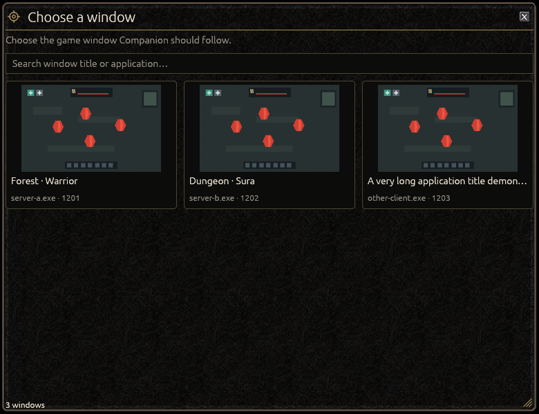
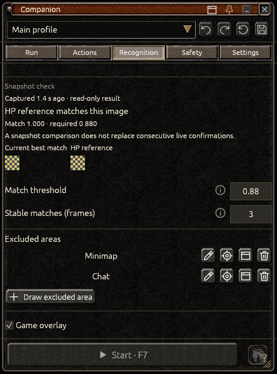
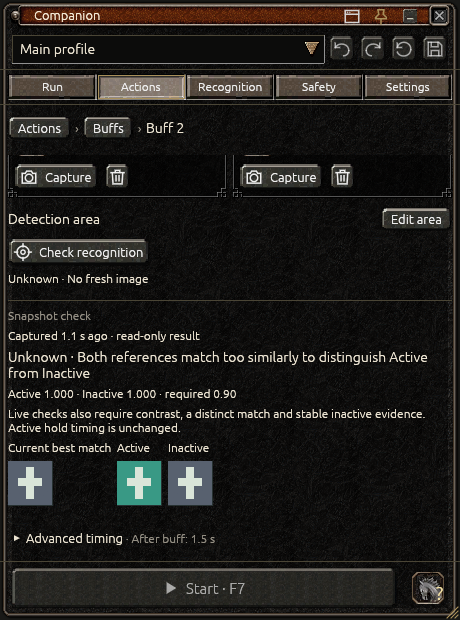
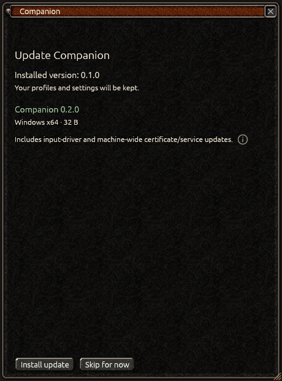
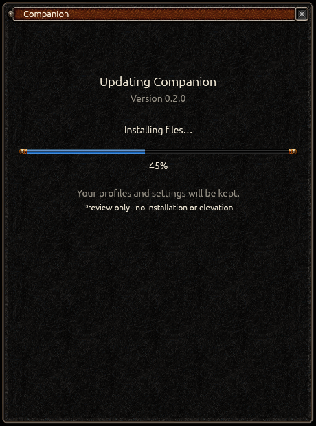

# Companion user guide

Companion is a Metin2 bot for Windows. This guide covers connecting it to your game, choosing what it should do and understanding its status.

[First setup](#first-setup) · [Recognition](#recognition) · [Actions](actions.md) · [Run and stop](#run-and-stop) · [Updates](#updating-companion) · [Troubleshooting](#data-and-troubleshooting)

## Installation and HID driver

Download **CompanionSetup** from [Releases](https://github.com/ethanjojo/metin2-bot/releases) and follow the installer. You need 64-bit Windows 10 version 2004 or newer and Direct3D 11 graphics support.

Setup requests administrator approval and installs the required HIDMaestro input driver. It also adds a local signing certificate to trusted Windows certificate stores and configures the GameInput service. Read the disclosure before accepting. The app and installer are unsigned, so Windows does not show a verified publisher. [Installation details](installation.md) explains these changes, backups and driver removal.

## First setup

1. Start your game and open Companion. Finish or skip the startup update check.
2. Select the game window from the screenshot grid. Use search if several windows are open.
3. Choose or create a profile from the selector at the top.
4. Complete the three **Recognition** settings below.
5. Open **Actions** and enable the behaviors you want. Confirm your character's mount state using the horse icon in the footer.
6. Review setup warnings in **Run**, save, and press **F7** or **Start**. Press **F8** whenever you need to pause.

The chooser refreshes automatically. The window button in the title bar lets you choose another game window later.

## Recognition

Open **Recognition** and configure:

| Setting | What to select |
| --- | --- |
| Search area | The part of the game where Metins may appear, or the full game window. |
| Metin detection | A representative target color, or a saved detection preset. |
| HP panel reference | A small, distinctive detail that appears when a target is selected. |

For the **HP reference**, capture a fixed decoration or corner of the panel. Avoid the monster name, changing health fill and other variable text. Companion searches the whole game window for this detail, so it can work with different panel lengths.

### Selecting and editing areas

**Pick** or **Edit** opens a darkened, frozen view of the game. Draw the area you need; an existing area can be moved or resized. Use **Confirm** or Enter to accept. Escape or F8 cancels without changing the saved selection.

Add **Excluded areas** over chat or the minimap to ignore targets there. Each area has controls to rename, show, edit or delete it. Undo restores a removed area.

The Metin detection row shows the current color. Its pencil opens color tolerance, size limits and confirmation settings together. Save a useful setup as a named preset with **+**. Applying a preset copies its settings into this profile; changing the preset later does not change your other profiles.

### Check recognition

Use **Check recognition** beside the HP reference or an image-based buff. The dialog compares a fresh game image with your references without clicking or pressing keys.

- **Match / no match:** compare the current crop with your reference and the required score.
- **Active / Inactive / Unknown:** see which buff appearance was recognized. Unknown means the images do not allow a confident decision.
- **Check again:** take another image. **Edit reference:** replace the reference. **Close:** return to the form.

The result describes that captured image, not a permanently live status. It shows when the image was taken and whether unsaved settings were used. Close the dialog before starting.

### Game overlay

**Game overlay** shows recognition over the game. **Detected targets** shows candidate outlines; **Calibration areas** shows configured regions; **Sizes (px)** adds dimensions. Green marks the current target, and gold marks the next one.

These options change what is displayed. Turning off the overlay does not disable recognition. The overlay hides when the game is minimized or its image is no longer current.

## Calibration size review

If the game size changes, choose **Review calibration**. Check the preserved areas on the new image, move or recapture anything that no longer fits, then choose **Confirm calibration** and save.

Nothing is automatically stretched or deleted. **Cancel review** or Escape restores the previous calibration, including edits made during that review. The bot remains paused.

## Actions and Safety

**Actions** contains Buffs, Loot, Mount, Periodic actions, Visual rules, Auto-puller and Out-of-target attack. Select a behavior to open its settings; the path above the form takes you back. [The Actions guide](actions.md) explains each one with examples.

In **Safety**, choose optional limits and alerts:

- **Stop after active time:** stop after the chosen running time. Manual pauses and breaks do not count.
- **Stop at local time:** stop at the next occurrence of a clock time, including during pauses or breaks.
- **Take regular breaks:** finish the current target and loot, then rest for the chosen duration.
- **Recovery:** try clearing a timed-out target and rotating the view a limited number of times; pause if that does not help.
- **Notifications:** choose sound, Windows notifications or both. Use the test button to check them.

If both stop limits are enabled, the earlier one wins. An automatic stop does not restart itself. Pausing during a scheduled break cancels automatic continuation. Windows notification settings or Do Not Disturb may hide alerts.

## Compact panel and profiles

Use the title-bar controls to choose a window, pin, collapse or close Companion. Drag the frame to move it and resize its edges. Position and expanded size are remembered for the game window. **Settings → Appearance & performance → Reset position and size** restores the default placement.

The profile selector includes search and **New profile**. A profile's pencil renames it; check/Enter saves the name and cross/Escape cancels. Beside the selector:

| Control | Effect |
| --- | --- |
| Save | Keep the current profile edits. |
| Revert | Restore the last saved profile. |
| Undo / Redo | Step backward or forward through edits. |
| Changes badge | Compare saved and edited values; select a change to open its setting. |

One color, area or buff reorder counts as one logical change. A buff without a shortcut is listed as incomplete and will be omitted by Save. Complete it first if you want to keep it.

Open the **profile selector** to find **Duplicate**, **Export…** and **Import…**. An export includes settings and captured images. Import previews the package and creates a separate profile.

## Run and stop

The activity card shows what the bot is doing and why. Its bar counts down to the next step or a timeout; it is not target health. Setup warnings link to settings that need attention. **Setup complete** means configuration is ready, not that the bot is running.

| Control | Use |
| --- | --- |
| Start / F7 | Save valid edits and start after the countdown. |
| Pause / F8 | Stop immediately and release held input. F8 also works while Companion is minimized. |
| Horse icon | Confirm current mount state: grey = unknown, red = on foot, green = mounted. |
| Reset session | Pause, clear counters/history and restart timed buff timers. Mount confirmation and Safety limits are retained. |

Keep the selected game in the foreground. Switching away, losing the connection or changing game size can pause the bot. Read the reason and use its suggested action before starting again.

Click **Metins/min** to switch to average seconds per Metin. This includes the full active cycle: searching, combat and loot. **Recent activity** shows the newest events that fit; **History** opens the longer event list inside Run, with a **Warnings only** filter. Clearing history does not delete the log file.

## Updating Companion

Companion checks for updates when it starts. Choose **Install update** or **Skip for now**, or **Continue** if you do not want to wait for the check.

**Settings → Updates** also lets you check manually and choose a channel:

- **Stable:** regular releases.
- **Preview:** regular releases plus testing versions such as review, rc and dev.

The app downloads and checks the package, backs up the installation and data, then shows installation progress. Approve administrator access if requested. Updates reopen Companion paused and preserve profiles. Downloading can be cancelled; replacing installed files cannot. If an update fails, keep its message and logs and retry after resolving the cause.

Update checks do not upload profiles, screenshots or game data. Update illustrations use demonstration versions.

## Settings and appearance

**Combat & timing** contains target, rotation and action delays. Choose a timing preset or edit values individually. **Appearance & performance** adjusts UI scale from 75–150% and preview refresh. **Lite mode** reduces preview refresh without changing recognition or Safety checks. Companion uses one Metin-style appearance.

Hover a control or info icon for help. Use **Diagnostics** to inspect recent logs or export a report when reporting a problem.

## Data and troubleshooting

Profiles, images, settings and logs are stored in **%LOCALAPPDATA%/Companion**. Back up the whole folder while Companion is closed. The log is **logs/run.log**. Ordinary uninstall keeps your data; [installation details](installation.md) covers backups and driver removal.

| Problem | What to check |
| --- | --- |
| Game is missing from the chooser | Start the client, reopen the chooser and search its title. |
| Start is disabled | Read the setup warning in Run. Check Recognition, buff shortcuts, mount confirmation and driver readiness. |
| Mouse moves but clicks or keys are ignored | Confirm the game is selected and focused. Check the input-driver message; run setup again if the driver is unavailable. |
| Too many or too few Metins are found | Check color, search area, exclusions and detection preset settings. |
| A selected target never confirms | Recapture a fixed HP-panel detail without the name or changing health fill. |
| A buff flickers or stays Unknown | Capture distinct Active/Inactive appearances and adjust Keep Active for (s); see [buff recognition](actions.md#buffs). |
| Updates says Up to date | Testing versions are offered only on Preview. Check the channel. |
| An update fails | Keep its message and setup log. Close other Companion instances before retrying; do not delete active update backups. |

If you still need help, include the version, exact message and a Diagnostics report. Review reports and screenshots before sharing them.

[Actions guide](actions.md) · [Installation details](installation.md) · [Release notes](release-notes.md) · [Developer documentation](development.md)
