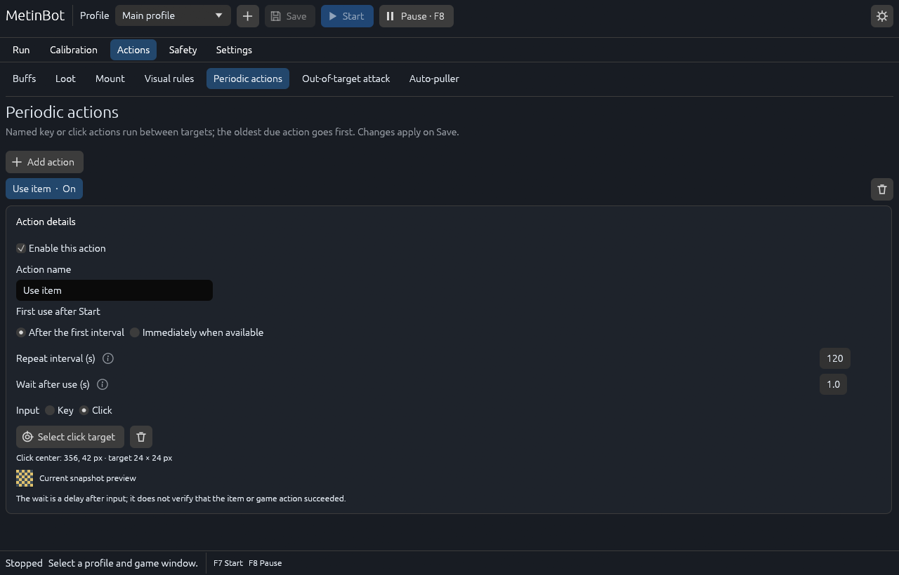
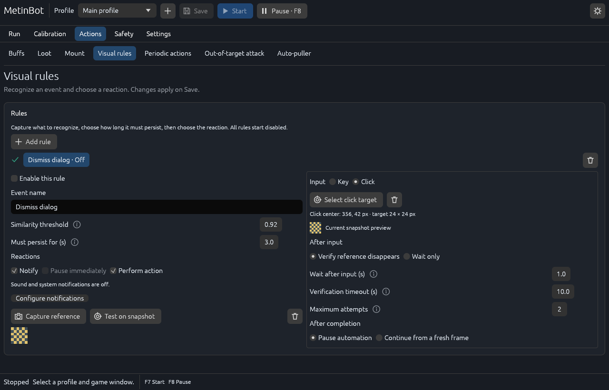
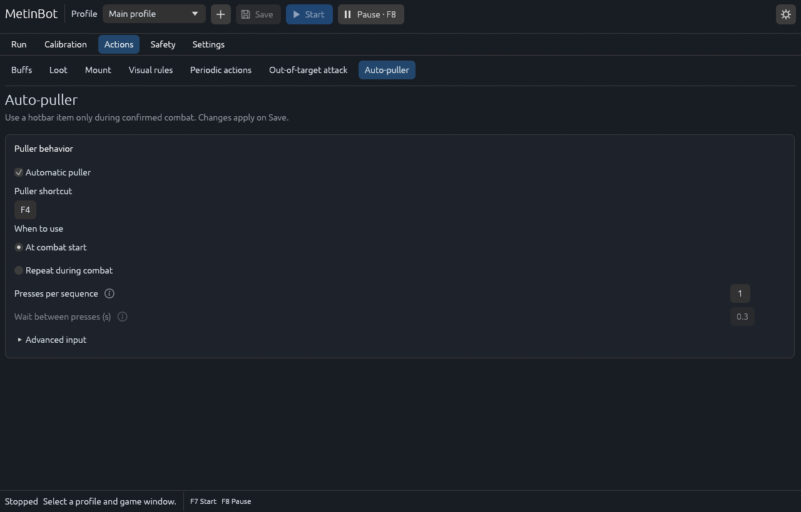
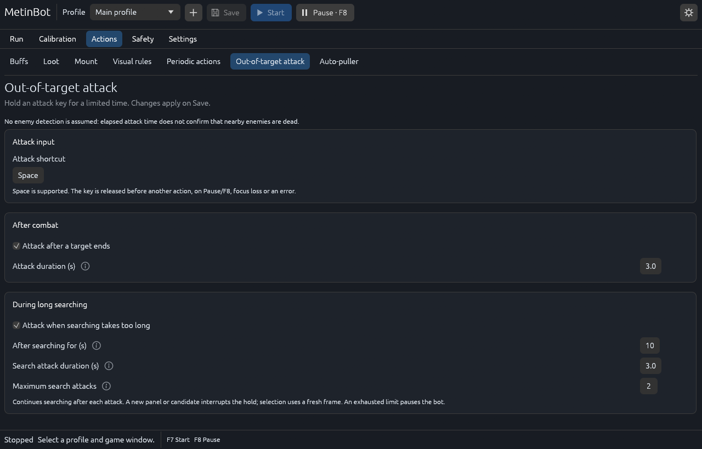
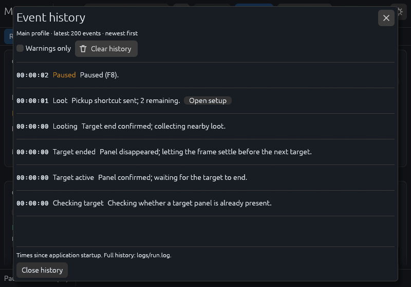

# User guide

## Profiles and game window

Use the top bar to create or switch profiles. Save persists the complete calibration, settings and skills. Each profile remembers its game-window selection. In Calibration, open the window picker, search by title/process and refresh when a client opens/closes. Search text is temporary. Ambiguous/closed windows need an explicit selection; the app does not attach to an arbitrary replacement.

## Calibration

1. Select the correct game window and take a Snapshot. Keep the game dimensions/UI layout consistent with this calibration.
2. Set a search area containing the playable scene. Exclude the inventory, minimap and other false matches with excluded areas.
3. Set Metin color using the color controls/picker. Detection settings control tolerance, dimensions and stability.
4. Select the target panel and a distinctive reference crop inside it. Avoid changing HP/name regions. A reference crop must be at least 5 by 5 source pixels and contain enough visual detail; a uniform crop can be rejected even when large enough.
5. Enable Detections to inspect results; enable Sizes (px) independently to display region dimensions.
6. Save and inspect the readiness information in Run before starting.

Editing mode is shown in the canvas toolbar. Click an area/capture control, then drag on the frozen image; Escape cancels the current operation. Selection instructions and compact control explanations are available on hover. Trash icons remove the corresponding area/color/icon. Drag inside a selected rectangle to move it; drag its handles to resize. Undo/redo restores edits within the current profile. The wheel or +/- zooms, middle-drag pans, and Fit restores an overview.

Live preview observes the selected game window and sends no input. Take a Snapshot to edit. Windows capture targets the selected window rather than whatever occupies the desktop. A capture/permission error is displayed instead of falling back to browser/desktop pixels.

While paused, continuous capture runs only for the Run preview or Calibration with Live preview enabled. Snapshot requests one fresh frame. Other pages and frozen calibration do not keep capturing in the background. Active automation always uses its configured detection interval.

## Actions

### Buffs

Select a skill to edit its shortcut, mode and timing. The two compact arrows beside its list button reorder it; the adjacent trash icon removes that skill. Recognition is relevant to Activate when inactive skills. Supply the required area and active/inactive icon references according to the configured mode.

Capture controls open Calibration with the skill name and selected capture type. Take/verify the crop, inspect its thumbnail, then use Done & back to buffs. A failed capture shows the validation reason and does not replace a valid saved icon. Configure the actual current On/Off state before running when the skill requires it.

### Loot

In Actions → Loot, enable Automatic loot and record the game’s pickup shortcut. Set the number of presses, initial delay, wait between presses and key hold duration. Loot starts only after a confirmed target panel disappears for the configured number of frames. Startup, unconfirmed clicks and search rotations do not trigger it. It sends a pickup shortcut; it does not recognize item names or inventory contents. A target panel reappearing interrupts pickup and pauses automation.

### Mount

Run and Actions → Mount share the actual current On foot / Mounted declaration. Select and connect a game window, check the character and confirm its state; no Snapshot or calibration is required, even when other profile settings are unfinished. Actions → Mount also contains desired Fight mounted behavior, the mount shortcut and delays. In Run, the declaration sits inside Current activity: a confirmed state shows Change, while an unknown state offers On foot / Mounted directly. Explanations are available under the info icon. Declaration applies immediately and pauses automation. Other settings apply on Save. Mount handling runs as part of Automatic buffs.

Each new profile/window connection starts with unknown mount state. Check the character and select On foot or Mounted before starting automatic buffs. Saving the same connected session preserves its declaration; switching connections or restarting the app requires a new declaration. The state is never borrowed from another character.

### Periodic actions



In Actions → Periodic actions, use Add action to create a named key or click action. For a key, record the shortcut and hold duration. For a click, select its area on a calibrated snapshot. Set the repeat interval and wait after use, then enable and save. First use after Start offers After the first interval (the default for new actions) or Immediately when available. Actions from older saved profiles retain immediate first use; saving writes the updated format.

Actions run between targets, never during combat. After successful input, the next interval starts after the configured wait. Manual pauses and scheduled breaks freeze these intervals. The wait is only a delay: it does not verify that an item was used or a game action succeeded. This is a single input, not a dialog sequence.

The action and its animation wait do not consume the search timeout. Time already spent searching is retained when searching resumes.

Click areas use source pixels relative to the calibrated game window, not desktop coordinates. Select a stable button area and recalibrate after changing game size or layout. A changed frame size clears click areas and disables affected actions. Focus, window and input guards apply to clicks as well as keys.

### Visual rules



In Actions → Visual rules, use Add rule and name the event. There are no death/disconnect presets or supplied game images. Capture a distinctive fixed part of the event (5–128 source pixels), inspect its thumbnail and return to Visual rules. Test on snapshot compares the reference with the frozen frame; compare normal and event snapshots before enabling. Set similarity and how long the event must persist. Missing or stale observations reset persistence; a rule fires once until its condition disappears. Enabled rules require complete calibration.

Choose independent Notify, Pause immediately and Perform action checkboxes. Notify can be combined with either behavior or used alone. Immediate pause and performing input are mutually exclusive; neither selection silently changes the other. A rule without any reaction cannot be enabled. Perform action uses one recorded key (with hold duration) or a calibrated click area. The app releases ongoing attack input and checks a fresh frame before sending the action. Click areas follow the same game-window-relative calibration rules as periodic clicks.

Verify reference disappears is the default result check. After the configured wait, fresh consecutive frames must confirm that the rule's reference has disappeared. If it remains after the verification timeout, the action may retry, up to Maximum attempts (1–5 total attempts, including the first). Exhausting attempts pauses automation. Notify controls alerts from this rule, including retries and failures; history and warning reasons are always recorded. During a visual action, this also covers focus, capture and input errors. Scheduled automatic stops retain their independent alerts. When sound and system notifications are both off, the rule shows a shortcut to Safety → Notifications. Wait only explicitly skips outcome verification: the event history records that only the delay completed. It does not prove revival, reconnection or any other game result.

After completion, choose Pause automation (the default) or Continue from a fresh frame. This completion pause can be combined with performing an action; it is distinct from Pause immediately. Continue discards the interrupted sequence and recognizes the game state again; it does not resume stale clicks or attacks. If mount state became uncertain during interrupted buffs, the app pauses for a manual check. A visual action detected during a scheduled break pauses for review.

Pause/F8, focus loss, geometry changes, capture/input errors and automatic safety limits cancel execution and release held input. Cancelled work never resumes automatically after Start. Rules that pause take priority over action execution. Test recognition and the configured input in your own setup before enabling; live-game acceptance is still pending.

### Auto-puller



Assign the shortcut of your enemy-attracting hotbar item. At combat start sends one sequence after the target HP panel is confirmed. Choose the number of presses and gap between presses. A brief panel flicker or Pause/Resume does not trigger another start sequence for the same combat. Repeat during combat sends a sequence immediately when combat is confirmed, then repeats after the configured post-sequence wait and interval. No puller inputs are sent while searching, acquiring a target, looting, buffing, recovering or on break. A pause cancels remaining presses; delayed samples never replay missed sequences. Advanced input controls the key hold duration.

Profiles saved with the previous Searching/Combat/Both periodic modes load as Repeat during combat, preserving their shortcut/timing. The next save writes the new mode. Newly created profiles default to At combat start with the puller disabled.

### Out-of-target attack



Actions → Out-of-target attack has independent, default-disabled options for after combat and long searching. Set the attack shortcut (Space is supported).

After combat starts only after confirmed target-panel disappearance, holds the key for the configured duration, releases it, then continues with loot and settling. It does not run after startup or an unconfirmed click. During long searching triggers after the configured search time with no target; search/rotation settling counts, pauses and other actions do not. It holds the key for its own duration, then resumes fresh searching. A new panel or stable candidate interrupts a search attack before selection. Maximum search attacks is bounded; existing search/rotation/recovery limits still apply and may stop the run first. Attempt counts reset after confirmed combat or a manual Start, not Reset statistics.

These are timed key holds, not monster recognition: finishing a hold does not prove nearby enemies are dead. Vision and safety monitoring continue during a hold. A panel appearance, Pause/F8, focus/geometry change, capture failure or safety limit releases the key; no hold resumes automatically after a pause. Slow capture during a hold fails closed rather than continuing a blind attack.

## Safety

All options are per profile and disabled by default. Save applies edits; changing stop/break settings restarts the safety budget. Editing visual rules in Actions, recovery or notifications preserves that budget. Keep the game focused during scheduled breaks if you want automatic continuation.

- **Stop after active time:** counts searching, combat, buffs, pickup and settling. Manual pauses and scheduled breaks do not count. The limit interrupts guarded input and releases held keys, including during combat.
- **Stop at local time:** fixes the next occurrence of the chosen local time when a new run starts (tomorrow if necessary). This deadline continues through pauses and breaks. Later system-clock/time-zone changes do not move the already fixed deadline. During a daylight-saving gap the next valid occurrence is used; repeated local times use the first future occurrence.
- **Take regular breaks:** after the configured active interval, waits for the current target, loot and settling to finish. No inputs are sent during the break. Buff timers freeze and recognition restarts on a fresh frame afterwards.

If both stop limits are enabled, the earlier one wins. A completed automatic stop never restarts by itself: Start or F7 explicitly begins a new run and fresh safety budget. Pause, F8, focus loss or an error during a break cancels automatic continuation; the next manual Start begins a fresh break interval. Pausing outside a break preserves active-time progress. Reset statistics, Reset skill timer and Clear history do not reset safety limits. Changing profile/window or restarting the app begins a new runtime session.

The execution order is target end → optional out-of-target attack → loot → settling → break if due → buffs → periodic actions → next target.

### Recovery and notifications

Recovery optionally clears a timed-out target with Escape, rotates the camera and waits for fresh recognition. Attempts are bounded; exhausting the limit pauses. Recovery never counts a target completion or triggers loot. Attempts reset after a confirmed target end or manual Start.

Notifications optionally play a sound and/or submit a local system notification for rules, automatic stops and runtime errors. Test notification needs no game window. Delivery status and failures appear in Safety and Diagnostics. Desktop permissions and Do Not Disturb can suppress presentation; Linux sound-only alerts require `canberra-gtk-play`. No remote messaging is configured.

## Run and stop

The bot always starts stopped. Review the readiness message, save, and use Start or F7. Run places current activity, the reason and relevant countdowns at the top, with direct links for unfinished setup. The read-only game preview sits beside statistics and upcoming actions in wide windows and stacks above them in small windows. Turn Live preview off to stop continuous capture while paused; active detection and safety processing keep their configured interval. Detection colors distinguish the current target, next eligible target and other candidates. The game must be foreground and match the calibration. The application pauses/rejects unsafe input when window identity, focus, size, permissions or manual-input guards fail.

Pause or F8 stops the worker; do not rely on closing a game window as the primary stop control. Test the full game cycle before unattended use. Linux/macOS currently have no accepted capture/input backend and therefore cannot Start automation.

### Event history



Run also shows upcoming periodic/puller timers and recovery attempts. Click an action or skill name to open its exact editor; click Safety schedule or its countdowns to adjust breaks and stopping. Configure actions opens the Actions tab. Event links open the relevant action, rule, recovery page or calibration.

Run keeps a summary of the latest five events. Show full history and the activity-panel history button open a dialog with the newest 200 events for the connected profile/window, including starts, target changes, pickup, buff/mount actions and pause reasons. Times are elapsed since application startup. The dialog has its own scroll area; closing it with the cross, Close history or Escape preserves the Run page position. Warnings only filters the dialog, while the five-event summary stays unchanged. Clear history removes the in-memory list, while the full event log stays in `logs/run.log`. Changing profile/window starts a separate history.

## Settings and appearance

Actions, Safety and Settings use a second row of tabs for navigation. Settings has Detection, Combat & timing, Appearance & performance and Diagnostics pages. Timing presets show concrete values; manual edits become Custom. Appearance saves UI scale and preview refresh globally. Lite mode refreshes previews at most once per second and does not change detection or safety processing. Diagnostics can read recent local logs and export structured version/platform/session/events JSON; exports omit profile images and raw log files. Safety has its own tab. Invalid values prevent the affected action and display a reason. The far-right sun/moon control switches theme and remembers the choice. Runtime Windows/X11 icons follow that choice; Wayland launchers use the installed contrast icon. macOS has a bundle/Dock implementation awaiting native acceptance.

## Data and troubleshooting

Windows data: `%LOCALAPPDATA%/MetinBot`; Linux: `$XDG_DATA_HOME/MetinBot` or `~/.local/share/MetinBot`; macOS: `~/Library/Application Support/MetinBot`. Logs are in `logs/run.log` beneath that folder. Keep profile JSON and PNG assets together when backing up/importing.

If no window appears, refresh and confirm the client is running. If Start is unavailable, read its readiness explanation rather than repeatedly clicking it. If capture/input fails, check the selected window, foreground focus and privilege level. Recalibrate after resizing or changing the game's UI layout.

A diagnostic self-test uses temporary data and no game input:

```powershell
.\MetinBot.exe --self-test --self-test-report C:\Temp\metinbot-selftest.json
```

Use a writable report folder. The release executable still requests its normal UAC confirmation. Self-test verifies storage, vision and headless themes; it does not prove game reaction, native GPU rendering or clean-machine installation.
